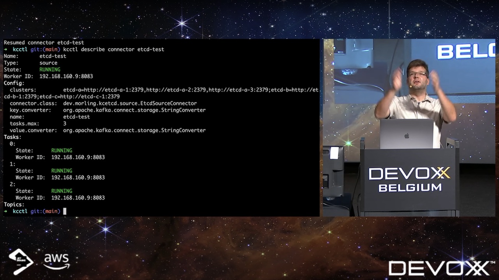
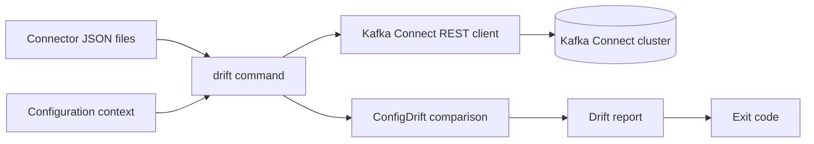

# Connect Drift Watch

A command-line tool that compares Kafka Connect connectors' live configuration with the JSON files they were registered from.



## Why

Connectors are usually registered from a JSON file kept in version control, but the running configuration on the cluster is what actually matters. During an incident someone patches a property by hand, the file is never updated, and the two quietly diverge. Comparing them by eye across a dozen clusters does not scale, and the drift only surfaces when a connector is re-applied and behaves differently. Connect Drift Watch makes that comparison a single command that can run in a terminal or in CI.

## How it works

The tool is a Quarkus command-line application built on Picocli. Each command reads the cluster URL from the current context in the local configuration file, builds a REST client for the Kafka Connect API, and prints a table or a list to standard output. The `drift` command reads the connector JSON files given on the command line, fetches each connector's live configuration from the cluster, and compares the two maps key by key.



`DriftCommand` is registered as a subcommand of the top-level command next to the others. For each file it reads the document with Jackson, takes the connector name from the `name` field and the configuration from the `config` object when the file has one, otherwise from the top level, and skips the `name` key in that second case. It then calls `getConnectorConfig()` on the Kafka Connect API for that name. A connector that is not registered, a file that cannot be read and a file without a name each print a message to standard error and end the run with the software exit code.

The comparison itself lives in `ConfigDrift.compare()`, which takes the file's configuration map and the live map and returns a `Drift` record holding the keys that were added, the keys that were removed and the keys that changed, each change carrying the file value and the live value. All three sets are sorted, so the report reads the same on every run. `DriftCommand` prints one block per drifted connector, with `~` for a changed property and both values, `+` for a key only on the cluster and `-` for a key only in the file, then a closing line with the number of connectors checked and the number that drifted. The command returns a non-zero exit code when anything differs, so a scheduled run fails loudly instead of silently, and `--quiet` leaves out the connectors that match.

## Key decisions

- The drift check is a subcommand of the existing CLI rather than a separate binary, so it reuses the context file, the REST client and the error handling that every other command already uses. The cost is that the tool carries the whole command surface for a single check.
- Comparison is a pure function over two maps, with no HTTP or printing inside it. That keeps it testable without a cluster, at the price of the command having to fetch and shape the data first.
- The command exits non-zero on drift instead of only printing. That makes it usable in a pipeline, but a caller that only wants a report has to ignore the exit code.

## Tech stack

- Java 21, Quarkus 3.40 with the Picocli extension
- MicroProfile REST Client for the Kafka Connect REST API
- Jackson for reading connector JSON files
- Maven build, JUnit 5, AssertJ, Testcontainers with Debezium's Kafka Connect container

## Quick start

Prerequisites: JDK 21 or newer and Maven 3.9 or newer. The integration tests need a running Docker daemon.

```bash
mvn clean package
java -jar target/quarkus-app/quarkus-run.jar config set-context local --cluster=http://localhost:8083
java -jar target/quarkus-app/quarkus-run.jar drift -f register-postgres.json
```

The context file is `~/.kcctl` and holds the cluster URL, an optional username and password, and the name of the current context. No environment variables are read by the code.

## Usage

```bash
$ java -jar target/quarkus-app/quarkus-run.jar drift -f register-postgres.json -f register-mysql.json
postgres-inventory: 2 properties differ
  changed  tasks.max: file=1 cluster=3
  removed  table.include.list: file=inventory.orders cluster=<absent>
mysql-orders: in sync
Drift found in 1 of 2 connectors
$ echo $?
1
```

## Project structure

```text
src/main/java/org/kcctl/
  command/        Picocli commands, one class per subcommand
  service/        REST client, response records and exception mapping
  util/           Configuration context, comparison logic, formatting helpers
src/test/java/org/kcctl/
  command/        Command tests against a containerised Kafka Connect
  util/           Unit tests for the comparison and configuration code
```

## Limitations

- Only connectors registered from a JSON file can be checked; connectors created through the REST API directly have no file to compare against.
- The comparison is exact on string values, so a property that the cluster normalises (for example a list reordered) is reported as drift.
- There is no scheduled mode; the check runs when it is invoked, so it needs a cron job or a CI step to run regularly.
- Secrets in connector configuration are compared as they come back from the API, which may be masked, so a masked value always shows as changed.

## License

Apache-2.0. The project builds on [kcctl](https://github.com/kcctl/kcctl), a command-line interface for Apache Kafka Connect, and keeps its Apache-2.0 licence.
